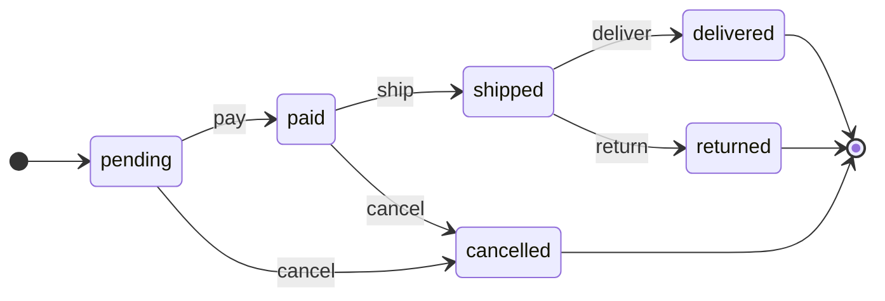
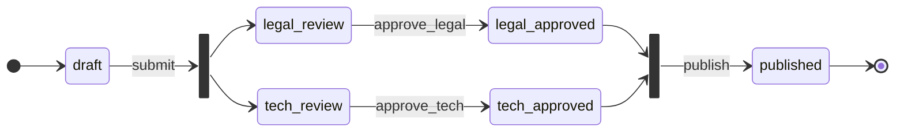

# statecraft

Finite state machines and Petri-net style workflows for PHP 8.3+.

Define the lifecycle of an entity once, with attributes on an enum or with a fluent builder, and get
a validated, immutable definition that the runtime enforces: guards, before/after hooks, PSR-14
events, an audit trail, and diagrams generated from the same source of truth.

The core depends only on `psr/event-dispatcher` and `psr/container` interfaces. No framework.

[](https://github.com/nikrybak/statecraft/actions/workflows/ci.yml)

## Quick example

```php
use Statecraft\Attribute\{State, StateMachine, Transition};

#[StateMachine(name: 'order')]
#[Transition('cancel', from: [self::Pending, self::Paid], to: self::Cancelled)]
enum OrderStatus: string
{
    #[State(initial: true)]
    #[Transition('pay', to: self::Paid, guard: PaymentCaptured::class)]
    case Pending = 'pending';

    #[Transition('ship', to: self::Shipped)]
    case Paid = 'paid';

    #[Transition('deliver', to: self::Delivered)]
    #[Transition('return', to: self::Returned)]
    case Shipped = 'shipped';

    #[State(final: true)] case Delivered = 'delivered';
    #[State(final: true)] case Returned = 'returned';
    #[State(final: true)] case Cancelled = 'cancelled';
}
```

```php
$machine = new Machine(
    (new AttributeLoader())->load(OrderStatus::class),
    new PropertyMarkingStore('status'),       // reads and writes $order->status, even if private
    events: $psr14Dispatcher,
    audit: new PdoAuditTrail($pdo),
);

$machine->can($order, 'ship');                                   // false: still pending
$machine->apply($order, 'pay', ['payment_id' => 'pi_123'], actor: 'user:42');
$machine->apply($order, 'ship');
$order->status;                                                  // OrderStatus::Shipped
array_map(fn ($t) => $t->name, $machine->enabledTransitions($order)); // ['deliver', 'return']

$machine->apply($order, 'cancel');
// TransitionNotAllowed: Transition "cancel" of machine "order" is not allowed:
// "cancel" cannot fire from the current marking [shipped]
```

The same machine as a diagram, produced by `MermaidDumper` (GitHub renders it inline):



And a workflow with parallel reviews, where `publish` waits for both approvals:



## Features

- **Two ways to define, one result.** `#[State]` / `#[Transition]` attributes on an enum or class, or `Definition::stateMachine('x')->...->build()`. Both produce the same immutable `Definition`.
- **Validation that catches real mistakes.** Unreachable states, dead ends, duplicate transitions, typos in state names, missing initial state, final states with exits. All issues reported at once, with machine-readable codes.
- **Guards** as classes (`Guard` interface, resolved from a PSR-11 container or instantiated), or closures. Guards see the subject, actor, metadata and current marking, and return a reason when they deny.
- **Hooks and PSR-14 events** (`TransitionStarted`, `TransitionCompleted`, `TransitionBlocked`, `GuardFailed`) with a documented order and failure semantics.
- **Workflows**: several places marked at once, forks and joins (a 1-safe Petri net subset).
- **Marking stores**: property (public or private, enum-aware) and getter/setter; implement the port for anything else.
- **Audit trail**: who, when, from, to and metadata for every transition. In-memory and PDO adapters, migrations for MySQL, PostgreSQL and SQLite.
- **Diagrams**: Mermaid `stateDiagram-v2` and Graphviz DOT, optionally highlighting the current marking.
- **CLI**: `vendor/bin/statecraft validate src/` fails CI when a definition breaks; `render` writes diagrams.
- **Engineering**: `strict_types` everywhere, readonly value objects, typed exceptions under one `StatecraftException` interface, PHPStan level max without a baseline, PER-CS, PHPUnit 11 with property-style random-walk tests, Infection configuration.

## Compared to a status column and if-statements

| Hand-written status column | statecraft |
|----------------------------|-----------|
| Allowed moves are scattered across controllers and services as `if ($order->status === 'paid')`. | Allowed moves are declared once; `apply()` refuses everything else. |
| A new status silently has no way out, or cannot be reached; nobody notices until production. | Unreachable states and dead ends fail the build (`statecraft validate`). |
| "Why can't I ship this?" requires reading code. | `blockers()` returns each reason, from the marking or from the guard. |
| History is an afterthought, often a few log lines. | Every transition is recorded with actor, time, from, to and metadata. |
| Side effects (emails, webhooks) are called inline next to the status change. | Listeners subscribe to events; before hooks can veto with an exception. |
| Documentation is a whiteboard photo that drifts from the code. | Diagrams are generated from the definition the code runs. |
| Parallel approvals become a combinatorial explosion of statuses. | Workflows mark several places and join them. |

A status column is fine for two states. Once there are guards, side effects and people asking
why something is stuck, an explicit machine is less code than the conditionals it replaces.

## Installation

```bash
composer require nikrybak/statecraft
```

Requires PHP 8.3 or newer. `ext-pdo` is needed only for `PdoAuditTrail`.

## Documentation

- [Attributes](docs/attributes.md)
- [Builder and validation rules](docs/builder.md)
- [Guards](docs/guards.md)
- [Hooks and events](docs/events.md)
- [Workflows and parallel states](docs/workflows.md)
- [Marking stores and audit trail](docs/persistence.md)
- [Diagrams and CLI](docs/diagrams.md)

Runnable examples: [order lifecycle](examples/order-lifecycle.php) (attributes, guard, hooks,
audit) and [document approval](examples/document-approval.php) (workflow, PDO audit on SQLite,
events, DOT export).

## Development

```bash
composer install
composer check        # php-cs-fixer (dry run), phpstan, phpunit
composer infection    # mutation testing, needs pcov or xdebug
```

## License

MIT, see [LICENSE](LICENSE).
